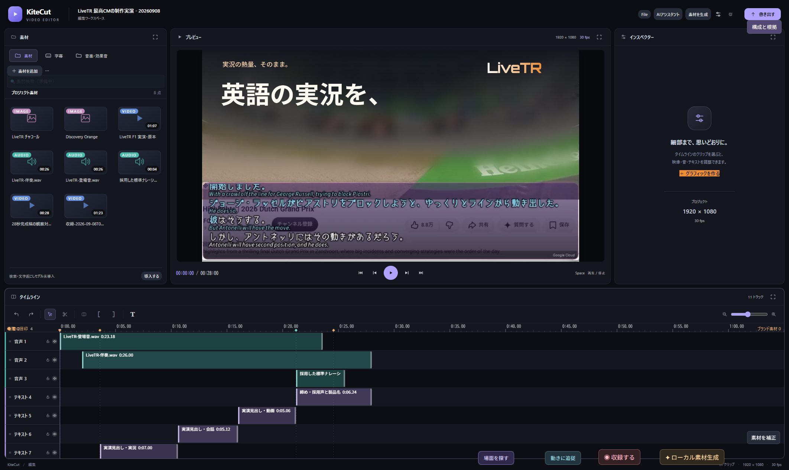
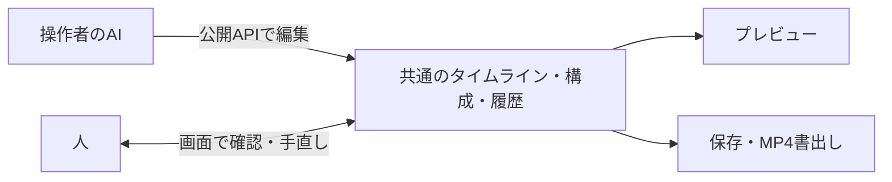

<h1 align="center">KiteCut</h1>
<p align="center"><strong>AIと一緒に仕上げる動画編集アプリ</strong><br>カイトカット · by <a href="https://github.com/kitepon">kitepon</a></p>
<p align="center">
  <a href="LICENSE"></a>
  <a href="https://github.com/kitepon/kitecut/releases/latest"></a>
  <a href="https://github.com/kitepon/kitecut/actions/workflows/source.yml"></a>
  
</p>
<p align="center"><a href="#制作実演">制作実演</a> · <a href="#はじめる">はじめる</a> · <a href="docs/ai-usage.md">AIから操作する</a> · <a href="CONTRIBUTING.md">開発に参加する</a></p>

AIが素材を見て構成を決め、人と同じタイムラインを編集するWindowsアプリです。編集の途中で止めて手直しし、その状態からAIに続きを任せられます。文字やロゴの動き、BGM・効果音・ナレーションを重ねて、MP4に仕上げます。

## 制作実演

**28秒のCMを作る過程を、約83秒の動画で。** 素材の配置から文字の演出、音声の追加、書出しまでを編集画面ごと収録しています。最後には完成したCMを大きく表示して通しで再生します。等速・音声ありです。

https://github.com/user-attachments/assets/6634566d-b285-4fe4-a004-9c305790660c

<sub>収録時のアプリ表示名はFrontstageです。現在の名称はKiteCutです。実演に使った制作素材はソース配布に含みません。</sub>

[実演の説明ページ](docs/demo.md)

## できること

| 作業 | KiteCutでの操作 |
|---|---|
| 素材を並べて編集 | 動画・画像・音声の取り込み、カット、トリミング、クロップ、位置・サイズの調整 |
| 文字とロゴを演出 | 日本語書体、文字組み、図形、キーフレーム、文字の出現・移動、パスに沿った描画 |
| 音を仕上げる | ナレーション、BGM、効果音、音量の時間変化、発話や拍を使ったタイミング調整 |
| 素材を観察・生成 | VideoChat3による動画理解、字幕認識、ローカルでの画像・動画・音声生成 |
| 人とAIで共同編集 | 画面とAPIでタイムライン・構成・履歴を共有。停止、手直し、再開、元に戻す・やり直す |
| 作品として保存 | プロジェクトの保存と再開、音声付きMP4への書出し、編集画面の収録 |



### AIの判断が、編集画面に反映される

構成やコピー、どこを切るかは操作者のAIが決めます。KiteCutはその判断を編集操作として実行し、人も同じ結果を確認・修正できます。動画理解や素材生成には、仕事の範囲を決めた補助モデルを使います。



## はじめる

現在は**Windows向けのソース公開版**です。PowerShell 7とwingetを用意してください。初回起動時に依存ソフトと採用モデルを取得するため、インターネット接続と大きな空き容量が必要です。

```powershell
git clone https://github.com/kitepon/kitecut.git
cd kitecut
pwsh -NoProfile -File .\Start-Editor.ps1
```

Gitを使わず取得する場合は、[最新版のソースZIP](https://github.com/kitepon/kitecut/releases/latest)を展開して、同じ起動スクリプトを実行します。Gitなど必要なツールは起動時にwingetから導入します。

1. 素材を取り込み、タイムラインに配置する。
2. 人の画面操作、または[AIの公開操作入口](docs/ai-usage.md)から編集する。
3. プレビューで確かめ、「書き出す」から動画を保存する。

### 動作を確認した環境

WindowsとNVIDIA RTX 5090（VRAM 32GB）で、動画理解、音声・画像・動画の生成、編集・書出しを確認しています。これは実測環境であり、最小動作要件を示すものではありません。ほかのGPUでの速度や必要容量は未測定です。GPUを使うモデル処理は順番に実行します。

ローカルの採用モデルはAPIキー・従量課金なしで利用します。操作者として使うAIや、アプリ内で選ぶ外部AIサービスには別途契約が必要な場合があります。

<details>
<summary>更新・保存先・依存の導入について</summary>

現在はWindows向けのソース公開版。インストーラーはまだ提供していない。

```powershell
git clone https://github.com/kitepon/kitecut.git
cd kitecut
```

WindowsのPowerShell 7で、このフォルダーの `Start-Editor.ps1` を実行する。

```powershell
pwsh -NoProfile -File .\Start-Editor.ps1
```

初回は公式パッケージと採用モデルをダウンロードするため、インターネット接続と大きな空き容量が必要。Git、Node.js、uv、Inkscape、7-Zip、共有FFmpegがなければwingetで導入する。PowerShell 7とwingetは実行前に用意する。モデルの取得・生成にはAPIキーや従量課金サービスを使わない。

同じ入口を実行すると、編集中の内容を保存し、採用版の依存とソースへ更新して最後の作品を再開する。現在の作品に操作中の処理がある場合は、保存と終了が成立したことを確認してから更新する。配布物を更新するときは作品と `.work` を残し、新しい起動コード・採用台帳・差分を展開してから同じ入口を実行する。

採用元の版を更新するときは、旧編集コードを `.work/editor-backups` へ退避する。適用途中で失敗した場合は旧版の復元を確認してからエラーを表示する。編集コードを自分で変更していた場合や、新しいファイルと衝突する場合は、その内容を保持して更新を止める。

依存とモデルは `.work`、作品はアプリで選んだ保存先に置く。既存のComfyUI Portableを利用する場合は、初回起動時に `MOVIE_COMFY_HOME` 環境変数へそのフォルダーを指定できる。場所は `.work/dependency-locations.json` に保存される。指定がない新規環境はアプリ配下へ公式Portableを導入する。

</details>
<details>
<summary>音声モデル・字幕認識・素材生成について</summary>

1. 素材を取り込み、タイムラインへ配置する。接続カメラや画面の収録から取り込むこともできる。
2. AIが構成を決め、公開APIから編集する。変更は人が使う画面・履歴にも反映される。
3. 人が手直しするときはAI欄で「外部AIの後続操作を停止」を押す。再開後、AIは最新のタイムラインを読み直して続きを編集する。
4. 保存して再開できる。完成したら「書き出す」から動画を出力する。

標準声は採用済みのQwen3-TTSによる声質参照、落ち着いた声はVOICEVOX Nemo女声6を使う。Nemoの音声を使う作品には「VOICEVOX Nemo」を表記する。音声選定とモデル版は採用台帳に記録し、起動時に別モデルへ置き換えない。

字幕認識は初回使用時にWhisperのモデルを取得して端末へキャッシュする。画像・動画生成はローカルComfyUI、動画理解はVideoChat3を使用する。アプリ内の外部AIサービスには別途契約が必要なものもある。外部API課金を必須にせず、操作者AIは同梱の公開操作入口から直接編集できる。

```powershell
node experiments/mcp-client.mjs tools
node experiments/mcp-client.mjs get_timeline
```

</details>

## 案内

| 知りたいこと | 入口 |
|---|---|
| AIから編集する | [操作の流れとAPIの使い方](docs/ai-usage.md) |
| ソースの構成を知る | [アプリの構成とソースの場所](docs/architecture.md) |
| 修正・機能追加を提案する | [開発案内](CONTRIBUTING.md)・[変更提案](https://github.com/kitepon/kitecut/compare) |
| 不具合・要望を報告する | [報告フォーム](https://github.com/kitepon/kitecut/issues/new/choose) |
| セキュリティの問題を知らせる | [非公開での報告方法](SECURITY.md) |
| 公開履歴を見る | [変更履歴](CHANGELOG.md)・[リリース](https://github.com/kitepon/kitecut/releases) |

## ライセンスと採用元

KiteCutは[Frontstage](https://github.com/x777/frontstage)を基盤に開発し、改変ソースと起動コードを**GPL-3.0**で公開しています。上流の固定ソースと改変差分を同梱し、起動時に完全な編集用ソースを展開します。

モデル、書体、外部ソフトにはそれぞれの利用条件があります。VOICEVOX Nemoの音声を使う作品には「VOICEVOX Nemo」を表記してください。

[ライセンス原文](LICENSE) · [第三者の権利](THIRD_PARTY_NOTICES.md) · [採用台帳](distribution/components.json)

<details>
<summary>配布物とソースの詳細</summary>

採用構成は [配布台帳](distribution/components.json)、第三者の権利は [同梱案内](THIRD_PARTY_NOTICES.md)、ソースのライセンス原文は [GPL-3.0](LICENSE) を参照する。元実演や個人の収録素材はソース配布に含まれない。

KiteCutは [Frontstage](https://github.com/x777/frontstage) を基盤に開発している。上流の固定ソースをGit bundle、変更を差分として同梱し、起動時に完全な編集用ソースを組み立てる。ソースの場所と変更手順は [開発案内](CONTRIBUTING.md) を参照。

`node experiments/build-distribution.mjs` で配布ファイルを作る。固定した上流ソース、改変差分、依存の採用台帳、起動用コード、書体とライセンスをまとめる。公開先への送信は行わない。

</details>
