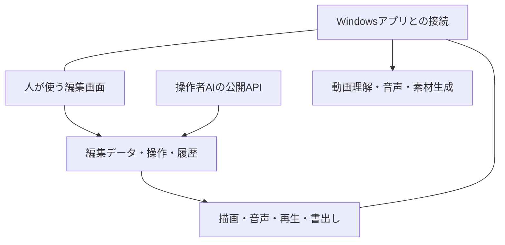

# KiteCutの構成

人とAIは共通の編集状態を操作します。描画・再生と保存・書出しもその状態を使います。

## ソースを探す

この公開版は、固定したFrontstageのGit bundleとKiteCutの改変差分から完全なソースを展開します。採用元と差分の一覧は [frontstage.json](../experiments/frontstage.json) にあります。モデルを取得せず読む手順は [開発案内](../CONTRIBUTING.md) を参照してください。

| 展開後の場所 | 責務 |
|---|---|
| `packages/core` | タイムライン、素材、構成、編集コマンド、元に戻す・やり直す |
| `packages/ui` | 編集画面、タイムライン、インスペクター、素材一覧 |
| `packages/engine` | 映像の復号、描画、音声、再生、書出し |
| `packages/ai` | 操作者AIが使う操作と入力形式 |
| `apps/desktop` | Electron、MCP接続、ファイル保存、収録、ローカルモデルとの接続 |

## 公開リポジトリの構成

| 場所 | 内容 |
|---|---|
| `Start-Editor.ps1` | 依存の準備、更新、最後の作品の再開を行う起動入口 |
| `experiments/` | 起動・更新用コード、採用設定、公開クライアント、書体、改変差分 |
| `distribution/` | 固定ソース、依存台帳、ライセンス、配布時の記録 |
| `scripts/` | 公開ソースの復元と同梱物を確認する開発用コード |
| `docs/` | 利用・開発案内 |
| `.work/` | 起動時に作る依存・モデル・編集用ソース。Gitの管理対象外 |

作品はアプリで選択した場所に保存されます。制作素材や認証情報は公開ソースに含みません。

[トップページへ戻る](../README.md)

